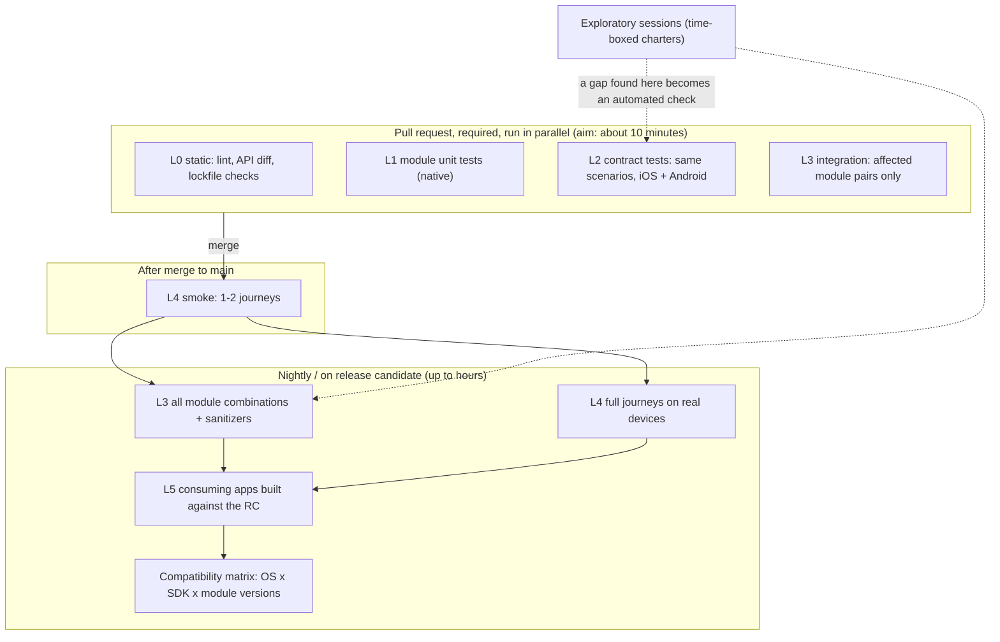
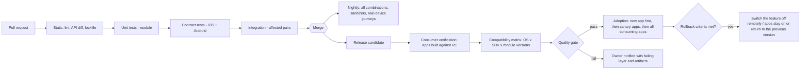
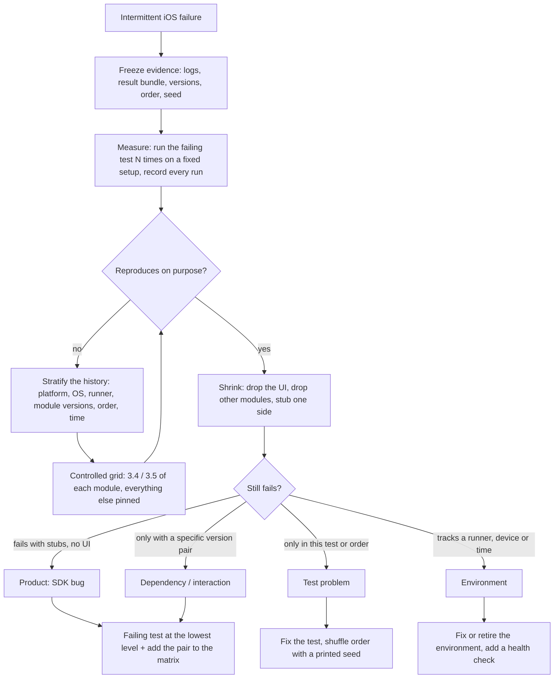

# Quality approach for the mobile platform SDK

My answer to the five questions in the brief, in order. The runnable part is in [`automation/`](../automation/README.md), the sample pipelines in `.github/workflows/` and [`ci/`](../ci), and my questions for the team in [`questions-for-the-team.md`](./questions-for-the-team.md). I only know the problem from the brief, so a lot rests on assumptions; they are in section 6 and several questions exist to confirm them. Numbers such as "10 minutes" are targets to agree, not measurements.

## The short version

Most of the problems in the brief (slow, unreliable end-to-end tests, integration failures found late, unclear compatibility) come from doing most of the checking in end-to-end tests. They are slow and don't tell you which module broke. iOS and Android drifting apart is a separate problem: nobody has written down the behaviour both must share. My plan moves most checks to lower levels and writes that shared behaviour down.

- Each module proves its own behaviour quickly on every pull request.
- Behaviour that must be identical on iOS and Android is written down once, as data, and run against both: contract tests.
- The build checks and records compatibility, so nobody has to remember it.
- End-to-end tests stay, but fewer of them, checking that things work together on a real device. Things like retry logic are tested lower down.
- A flaky test gets an owner and a deadline, like any other defect. If people learn to ignore red builds, nothing else here helps.

Two things about the setting affect the rest. First, this is a bank. Security behaviour (secure storage, certificate pinning, device integrity) and accessibility (the European Accessibility Act has applied to consumer banking since June 2025) need their own place in the plan, and release evidence has to satisfy change management and probably the bank's DORA records. Second, the SDK ships inside apps that go through the app stores, so a bad release can't be fixed in minutes. Catching problems before release, and being able to switch behaviour off afterwards, matter more than usual.

## 1. Test strategy

| Level | What it proves | Tooling (examples) | When |
|---|---|---|---|
| 0. Static | The change is allowed: lint, public API diff against the last release, dependency rules | Android: binary-compatibility-validator (or the ABI validation in recent Kotlin Gradle plugins). iOS: `swift package diagnose-api-breaking-changes` for source packages; `swift-api-digester` on the `.swiftinterface` files for binary XCFrameworks | Every PR. Seconds on Android; minutes on iOS, since the diff needs a build |
| 1. Module unit | One module's logic, neighbours faked | JUnit + MockK; XCTest / Swift Testing. Native, owned by the module team | Every PR, under a minute per module |
| 2. Contract | A module's *public behaviour* matches the written spec, identically on both platforms; and the fakes other teams use of this module still behave like the real thing | Shared scenario files (JSON) plus a thin native runner per platform (see `automation/`) | Every PR on the touched module |
| 3. Module integration | Modules together in one process: initialisation order, shared resources (HTTP stack, keychain, database), lifecycle | A small integration host app per platform linking several modules | PR: affected pairs. Nightly: all combinations, with sanitizers |
| 4. New app | Screens and flows with a stubbed backend, then a few real journeys | Compose test / XCUITest; a handful of real-device journeys | After merge: 1–2 smoke journeys. Nightly: full set |
| 5. Consuming apps | A release candidate doesn't break the apps that use it | RC published as a pre-release; each consuming app is built against it and runs its own smoke tests | Every RC |
| Cross-cutting: security | Secure storage, pinning, device-integrity behaviour, no secrets in logs | OWASP MASVS as the checklist; automated checks where possible (pinning rejects a bad cert, no token in logs); manual on real hardware | Automated: nightly. Manual: per release |
| Cross-cutting: accessibility | The SDK's own UI components (if any) have labels, scale with font size, keep contrast and focus order | Espresso `AccessibilityChecks`; XCUITest `performAccessibilityAudit()`; manual with TalkBack and VoiceOver | Automated: PR for UI modules. Manual: per release |



Most tests sit at the lower levels. When an end-to-end test fails, the first question is which lower level should have caught it, and the fix includes adding the check there.

**Automate** whatever has a clear expected result that must stay true: business rules, error handling, retry and timeout behaviour, header and payload shapes, version compatibility, migration of stored data between versions, parity between platforms. **Keep exploratory** what rewards a human noticing something odd or is brittle to automate: interruptions and lifecycle (backgrounding mid-request, the OS killing the app, connectivity changes, permission prompts at bad moments), first contact with a new flow, secure storage and biometrics on real hardware, OS betas, accessibility with real assistive technology. Sessions are time-boxed (60–90 minutes) against a written charter with short notes, and a finding an automated check could have caught gets that check written.

**Native or cross-platform**, decided per layer. The behavioural spec, the mock backend, run metadata and reporting are shared, because one source of truth keeps both platforms honest. Anything touching the platform is native (XCTest/XCUITest, JUnit/Espresso/Compose test): faster and more stable than driving the UI from outside, with sanitizers and native logs available. A cross-platform tool (Appium, Maestro) is only for the few journeys that should read identically on both, and only if the team would otherwise maintain two scripts. It is slower and flakier, so it stays small and off the PR critical path.

**Fast and maintainable.** I'd aim for required PR checks in about 10 minutes at the 90th percentile. With iOS builds in the mix that only works with build caching, running only what a change touches, and keeping device journeys out of the required set. I would measure today's number first and work towards the aim rather than promise it. Tests are hermetic: no real network, a fake clock, no `sleep`. What runs is selected from the module dependency graph, and the nightly run runs everything so selection mistakes show up within a day. Every test should say why it exists; tests with no clear purpose get reviewed and removed.

## 2. Automation example: networking and error handling

I picked networking because I expect iOS and Android to drift most there: different HTTP stacks and defaults, and details (what gets retried, what a timeout means, whether an error can leak a token) that are easy to get subtly different. Details and run instructions are in [`automation/README.md`](../automation/README.md). The idea:

- 30 scenarios in one JSON file are the specification: the server's scripted behaviour, the request, the expected result, and a `why`. Native Kotlin and Swift runners would read the same file ([sketches](../automation/native-runners/README.md)), run the whole catalogue in one go through a small control plane on the mock server, and hand their results to a separate parity step as plain files.
- The mock server records what it received, so every scenario is also checked on the wire: request count equals reported attempts, stable request ID, same idempotency key and body on every attempt. Parity compares only what the SDK itself sets, because two HTTP stacks add their own headers.
- Two simulated SDKs stand in for the platforms. **They are stand-ins written for the example, not real SDKs.**
- The tests are tested: the checker has its own tests, and a mutation check switches on 20 planted mistakes one at a time (after confirming the unmodified suite is green) and requires a failure for each.

Two different failures are demonstrated, because they need different tools. A **regression in one module** (iOS 3.5.0 retries a POST after a timeout, which could double-charge someone) is what contract tests are for. The failure in section 4 is an **interaction**, so there is also an init-order demo: three modules share one HTTP session and one overwrites the shared headers instead of merging. It fails in 4 of the 6 possible initialisation orders. In an app the order depends on what loads first, so it looks random; the test tries every order, and the failing test's name is the reproduction.

## 3. CI/CD and release validation



**Pull requests.** Required and fast: static checks including the API diff, the touched module's unit tests, its contract tests on both platforms, integration tests for the module pairs the change can reach. Smoke journeys run after merge, not on the PR. Nothing required depends on a real network or a shared environment. [`pr-checks.yml`](../.github/workflows/pr-checks.yml) runs the equivalent for the example in this repo (typecheck, tests, parity from files, the mutation check); it has no mobile code to build.

**Release candidates.** Each gate rule should be automated and easy to challenge:

- No breaking public API change without a major bump, and no change to the expected outcome of an existing contract scenario without one either (see compatibility below).
- Contract catalogue green on both platforms, and the parity step agrees.
- Compatibility matrix green for every combination the release claims to support; consuming apps build against the RC and pass their smoke tests.
- No new quarantined tests and none past their expiry.
- Budgets hold (binary size delta, cold start, memory in a reference scenario); dependency and secret scans clean; security and accessibility checks green; changelog and migration notes present.
- The release evidence (what ran, against which versions, with what result) is stored with the release. Change management will ask for it and it probably feeds the bank's DORA records; I'd check with the risk team what they need and in what form.

After the gate, the SDK team doesn't control what reaches users; the consuming apps do, when they adopt the version and through their own phased store releases. So a staged release here means the new app and one or two willing consuming apps adopt it first, and the others follow after an agreed period without problems. Rollback criteria (crash-free rate and SDK error rate against the previous version) are agreed before the release. A fix only reaches users with a new app release, so new behaviour ships behind a remote switch where possible, and "roll back" can mean "turn it off". [`ci/release-validation.yml`](../ci/release-validation.yml) lays out the stages. It is illustrative: the mobile build and check steps are stubs. What is real is the dependencies between stages, the parity step and the aggregation in the gate, which fails when any stage failed or was skipped.

**Slow and unstable tests.** They should stay visible without blocking everyone.

1. A test that fails and then passes on a rerun without a code change is flaky, and is recorded as such even if the rerun turned the build green.
2. A flaky test is quarantined within a day: it still runs, in a separate non-blocking job, with a named owner and a 14-day expiry after which it is fixed or deleted.
3. In the blocking path, at most one automatic retry, only for infrastructure failures (a simulator that didn't boot), always reported. Retrying assertion failures automatically hides real problems.
4. Slow tests have a per-test budget. Over budget means move to nightly or split.
5. Every run records its metadata: module versions, OS and device, runner image, test order and random seed. Without it an intermittent failure can't be investigated (section 4).

**Communicating failures.** The message names the level that failed, the owning module, the first failing assertion in plain words and where the evidence is (logs, request IDs, screenshots). On a PR that is a job summary, with a PR comment if the team wants one. Nightly failures are grouped by probable root cause, one message per cause with the owner tagged, and two red nights in a row become a ticket automatically. A short weekly review looks at the flake rate and the quarantine list.

### Compatibility

Four questions, each checked with the cheapest tool that answers it.

1. **Is the change allowed by its version number?** The API diff and semver at level 0. The API diff can't see *behaviour*, so the contract catalogue counts as part of the public surface: changing the expected outcome of an existing scenario (retrying where it used to give up) is breaking, so a major version or an opt-in flag. Adding a scenario is a minor change.
2. **Do the declared versions make sense?** Each module ships a small manifest and the build checks the resolved dependency set against it: Gradle dependency locking (`dependencyInsight` shows why a version was picked) and, on iOS, a committed `Package.resolved` *in the integration host app and CI* (a library's own `Package.resolved` isn't honoured by its consumers). By default Gradle quietly picks the highest version on a conflict, so the build sets `failOnVersionConflict()` (or an equivalent check) to make a conflict fail instead.

   ```yaml
   module: payments
   version: 3.5.0
   requires: { core: ">=3.4.0 <4.0.0", telemetry: ">=3.4.0 <4.0.0" }
   platforms: { ios: { minOS: "16.0" }, android: { minSdk: 26 } }
   contracts: { networking-scenarios: 1 }   # catalogue version it was verified against
   sharesResources: [http-session, keychain]
   ```
3. **Do the supported combinations work?** Contract and integration tests run across a matrix. The full product of module versions is too large, so I always test the set in production, the latest of everything, and a pairwise selection covering every pair of module versions at least once. OS: minimum supported, previous major, latest, plus the beta nightly. The **support window** (say the last two minor versions, with a deprecation period before anything is removed) is a decision for the team; whatever it is, the matrix is generated from it.
4. **Do the apps still work?** Consumer verification, level 5.

On contract tooling: consumer-driven contracts (Pact) fit where a consumer states what it needs from a provider, such as an app or the SDK against a backend, and I would use them there. For the SDK's own platform behaviour the SDK team defines the spec, so provider-owned scenarios run identically on two platforms are the better fit. The price is that I own the scenario format and the runners instead of using an established tool.

## 4. Investigation: module 3.4 to 3.5, intermittent iOS failure, only with two modules

The line I take most seriously is "neither module team can reproduce it independently". The interaction is the problem and nobody owns the interaction, so I would drive the isolation and bring both teams in.



1. **Keep the evidence.** Re-running until green loses what the failed run could tell you. Keep the artifacts of failing runs (full log, result bundle, crash report) with the metadata: exact versions of both modules and their dependencies, OS and simulator, runner, test order and seed. Also check field data (crash analytics, SDK error telemetry) to see whether it happens outside CI, and how often.
2. **Turn "sometimes" into a number.** Loop the failing test on a fixed setup and record every result (`xcodebuild test` can repeat with `-test-iterations` and `-run-tests-until-failure`). At 1 failure in 10, about 29 runs show it at least once with 95% confidence. The rate also says how long a fix must run clean before I believe it.
3. **Stratify, then run a controlled grid.** Which conditions do the failures share? The [triage tool](../automation/README.md#flaky-test-triage) ranks combinations of platform, OS, runner, module versions and test position (on made-up data it surfaces the planted cause, as a hypothesis, not proof). Confirm with a grid: 3.4 and 3.5 of module A crossed with 3.4 and 3.5 of module B, everything else pinned. If only 3.5 + 3.5 fails, the cause is in the interaction and I know which upgrade is necessary. Then diff the changelog and the source between 3.4 and 3.5 of those modules and bisect within the range.
4. **Shrink.** Remove the UI and run at SDK level, replace one module with a stub, compare a clean simulator with a reused one, a Debug build with a Release one, and static with dynamic linking (the last two change initialisation timing and symbol resolution). The smallest thing that still fails is the bug report. For an order problem, enumerate the initialisation orders instead of waiting (as the demo does). For a race, loop with injected delays at module boundaries to widen the window, and print the seed.
5. **Classify by evidence.**

   | Cause | What it tends to look like |
   |---|---|
   | Product (SDK bug) | Reproduces without the UI and on a real device; stack points into SDK code; tracks a module version |
   | Dependency / interaction | Needs both modules at specific versions; duplicate or conflicting transitive versions; depends on which module initialises first |
   | Test | Depends on order or timing; passes alone, fails in a suite; waits for a duration rather than a condition; shared state between tests |
   | Environment | Tracks a runner, simulator pool or time of day; durations spike; clusters after an infrastructure change |

6. **Diagnostics on iOS.** A Thread Sanitizer run (data races) and, separately, an Address Sanitizer run, since the two can't be combined in one build; the Main Thread Checker; strict concurrency checking for actor-isolation and queue mistakes; OS logging with one subsystem per module and signposts around module initialisation so the order is visible; an SDK build-info line at the top of every log; the request IDs the SDK already sends, to line up client and server views; the resolved dependency graph and a check for duplicate symbols when both modules statically link the same library; simulator state. Why iOS only is a clue in itself: iOS modules are often linked statically into one binary and initialise implicitly (static initialisers, `+load`, first use of a singleton), while Android modules usually initialise explicitly, and iOS has more process-wide shared state. First suspects for "two modules, intermittent, iOS only": a shared singleton or global that whichever module loads first configures (URL protocol or session configuration, keychain access group, notification observers, swizzling), an initialisation order dependency, a cache that isn't thread-safe. I would also check that Android is green for the right reason, meaning the same two-module scenario really exists there.
7. **Prevent.** The regression test goes at the lowest level that reproduces it deterministically (forced init order, injected delay), not in a UI test that fails by luck. The pair joins the integration matrix. The nightly run shuffles test order and prints the seed, and a Thread Sanitizer job runs nightly. Modules declare the shared resources they touch in their manifest, and a new module version is run against every module that shares a resource with it. Finally, a short review asks why the matrix didn't catch this.

## 5. First three priorities

**1. Make the test signal trustworthy.** *Why:* if developers have learned to ignore red builds, the other improvements won't stick. *Need:* CI history for 60–90 days, an inventory of what runs where, how failures are handled today and by whom. *Involve:* whoever owns CI, the module leads, QA from two consuming apps. *First outcome (2–3 weeks):* a one-page report of the ten worst offenders by flake rate and duration, the quarantine rule agreed and applied, run metadata recorded on every run.

**2. Make compatibility explicit.** *Why:* it is the source of the "who broke whom" confusion, and nobody can currently answer it quickly. *Need:* the module and consumer map (who uses what, at which version), release cadence, the support policy, past integration incidents. *Involve:* platform architects, release management, consuming-app leads. *First outcome:* a version matrix v0, even generated from lockfiles into a table, and the API diff running in report-only mode on one module so we see the noise before it blocks anyone.

**3. Prove the contract-test pattern on one capability.** *Why:* it is the quickest way to rely less on slow end-to-end tests and to catch iOS and Android drift, and teams are more convinced by a working example than by a document. *Need:* the incident list to choose the capability (my guess is networking or authentication, but data should decide), how that module is owned on each platform, what mock backend exists. *Involve:* the owning module team on each platform, since they write the native runner, and a backend contact for realistic scenario data. *First outcome:* one capability with around 15 scenarios running on every PR on both platforms with a visible report. If it catches a real divergence in its first month, expand to the second capability; if not, find out why before adding more.

I would not start by rewriting the end-to-end suite. It should get smaller as checks move to lower levels.

**How I'd work with the module teams.** The module teams own their tests, contract scenarios included. My part is the shared pieces (scenario format, mock server, pipeline, reporting), reviewing new scenarios with the teams, pairing on the first native runner with each team, and writing a short guide so the next team can start without me. A sign it is working: teams fix integration failures themselves, without waiting for QA to explain them.

## 6. Assumptions, risks and trade-offs

**Assumptions.** Modules ship as versioned packages from an internal registry (Swift packages or XCFrameworks, Maven artifacts). Both platforms are native (Swift, Kotlin). CI has macOS runners and emulator capacity. A staging backend exists or can be mocked. Module teams are separate from the platform team, and consuming apps belong to other teams. There is no agreed definition of a "supported version", and the organisation has change-control requirements I don't know yet.

**Risks and mitigations.** The scenario catalogue becomes a second spec nobody maintains: the module team owns it and reviews it with the module's PRs. Module teams see native runners as extra work: keep them tiny, give them a template, prove the value on one capability first. A passing contract test doesn't prove real OS behaviour matches (the stand-ins here prove nothing about that): real-device nightly runs and exploratory sessions. macOS CI capacity may limit what runs per PR. The matrix grows fast: pairwise selection and a clear support window. Over-building before understanding the team: priorities 1 and 2 are mostly listening and measuring.

**Trade-offs.** Scenarios as data keep behaviour in one place, but lifecycle and UI checks don't fit as data and stay native. A strict PR gate is safer and slower, so new checks start report-only and become blocking once trusted. Quarantine keeps the build usable but can hide real bugs, which is what the expiry and the visible list are for. Native UI tests beat a cross-platform tool on speed and stability, at the price of two scripts per journey.

**Left out on purpose.** Performance testing (a separate budget-and-baseline topic, worth its own plan once the basics are trusted), deeper security testing such as penetration testing (a specialist activity I'd coordinate, not replace), visual regression and test data management (valuable but downstream of the signal problem), choosing a device cloud (depends on cost and compliance, which I don't know), and real Kotlin and Swift runners (sketches only, because I can't compile either here).
